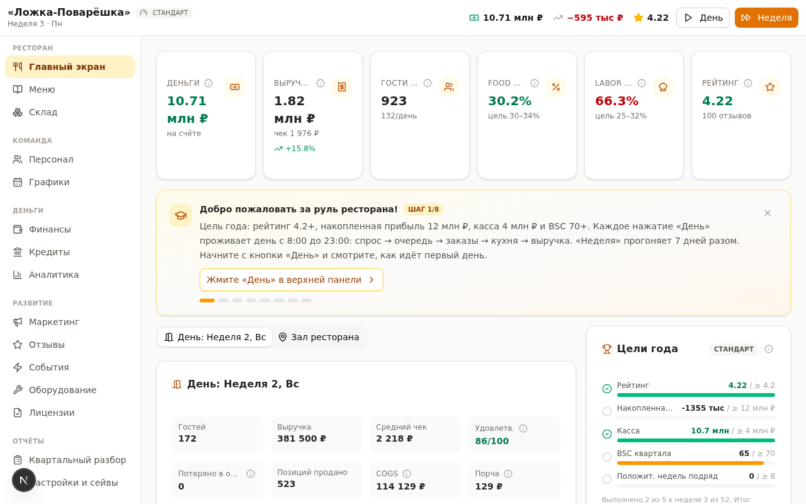
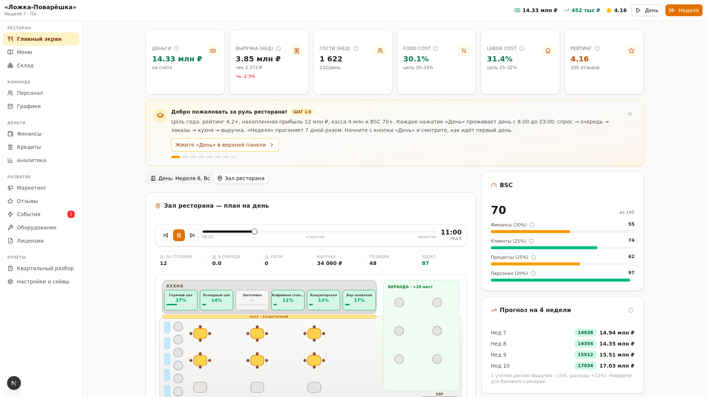
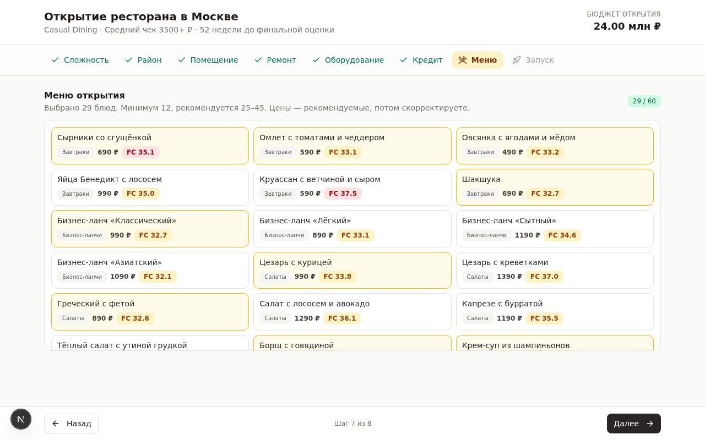
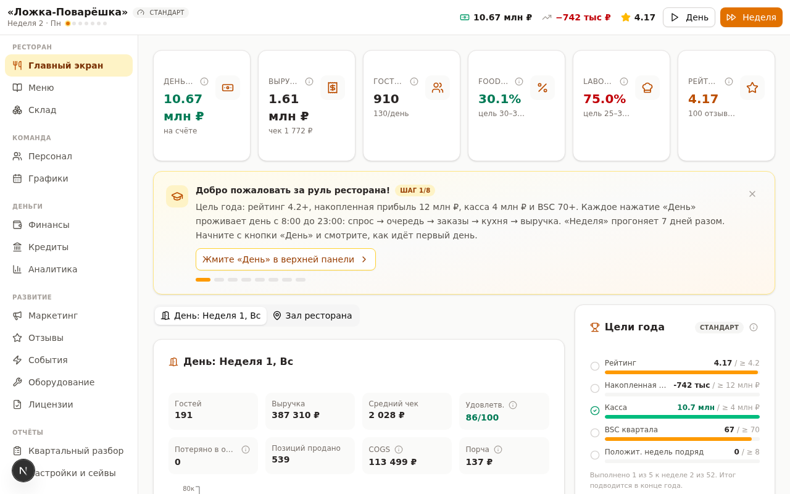

# 🍽 Ложка-Поварёшка — экономический симулятор ресторана

[](https://nextjs.org)
[](https://www.typescriptlang.org)
[](https://tailwindcss.com)
[](https://bun.sh)
[](#структура-проекта)

> Браузерная обучающая управленческая игра: вы — управляющий casual-dining рестораном в Москве.
> Горизонт — **52 недели** (один год). Цель — вывести ресторан в здоровую экономику и набрать
> максимум очков в финальном BSC-разборе. Побеждает не «герой дня», а системный менеджер.

| Главный экран | Зал и день |
|---|---|
|  |  |

| Мастер открытия | Цели и итоги |
|---|---|
|  |  |

---

## Что это

Симулятор ресторанной экономики с честной математикой: спрос
по сегментам аудитории, очередь на 15-минутных подшагах, кухня по станциям, склад с FIFO
и порчей, персонал с усталостью и текучестью, P&L отдельно от Cash Flow, налоги, кредиты,
репутация на байесовском рейтинге отзывов, события и дилеммы, Balanced Scorecard.

Игра учит главному: **прибыль ≠ деньги**, Food Cost 30–34%, Labor Cost 23–28%,
EBITDA 10–20% — и почему рестораны умирают от кассовых разрывов, а не от убытков.

## Игрок управляет

- **Открытием** — район Москвы (8 вариантов от Патриков до Митино), помещение, ремонт, бюджет
- **Меню** — 60 блюд с техкартами, цены, стоп-листы, Food Cost по каждой позиции
- **Складом** — FIFO-партии, сроки годности, автозаказ, срочная закупка +35%
- **Штатом** — 10 ролей, графики смен 2×8ч, переработки, усталость, мораль, найм/увольнение
- **Финансами** — эквайринг, взносы 30%, налоги, аннуитетные кредиты (DSCR, банкротство 8 недель)
- **Маркетингом** — 5 каналов с насыщением, чистота, генуборка
- **Рисками** — события (проверки, отравления, ЧС), дилеммы, кадровые кризисы
- **Преимуществами** — алкогольная лицензия, веранда (май–сентябрь), экспозиция витрины

## Ключевые особенности реализации

- **Детерминированный движок** — вся случайность через seed-потоки `mulberry32 + hash`
  (никакого `Math.random`). Один и тот же seed = идентичная партия до байта. Пресеты
  баланса: `moderate` / `aggressive` / `legacy`
- **Чистая архитектура** — движок (45 модулей, headless) полностью отделён от UI
  (27 React-компонентов); игровые действия — единый набор мутаций
- **Честные финансы** — единственная точка движения денег (транзакции), P&L и Cash Flow
  считаются раздельно, инварианты целостности проверяются каждый игровой день
- **Калибровка по эталонам** — 18 конфигов баланса, ~40 сценариев бенчмарков
  (`scripts/balance-v2-test.ts`), двойной прогон на совпадение
- **Сохранения** — LocalStorage, 3 слота, экспорт/импорт JSON, миграция форматов

## Технологии

Next.js 16 (App Router) · TypeScript 5 · Tailwind CSS 4 · shadcn/ui (New York) ·
Zustand · Recharts · Framer Motion · Lucide · Bun

## Запуск

```bash
bun install        # или npm/pnpm install
bun run dev        # → http://localhost:3000
```

Требуется Node 20+ или Bun. Серверная часть не нужна: движок исполняется на клиенте,
сейвы живут в LocalStorage браузера. Prisma присутствует как заготовка окружения
и в игровом цикле не участвует.

## Скрипты разработки

```bash
bun run lint                        # ESLint
bun scripts/balance-v2-test.ts      # бенчмарки баланса, двойной прогон (детерминизм)
bun scripts/full-game.ts            # headless-симуляция полной партии 52 недели
bun scripts/diag-stage6.ts          # диагностика конкретного этапа баланса

# пресеты баланса:
BALANCE_PRESET=legacy bun scripts/balance-v2-test.ts
```

## Структура проекта

```
src/
  lib/game/
    types.ts            # все сущности (GameState, Menu, Staff, P&L, BSC, ...)
    rng.ts              # mulberry32 + hashSeed + deriveRng (детерминизм)
    config/             # 18 конфигов баланса (demand, staff, finance, risks, ...)
    content/            # 120 ингредиентов, 60 блюд с техкартами
    engine/             # спрос → очередь → заказы → FIFO → персонал → финансы
                        # → репутация → события → BSC → финал
  components/game/      # 15 экранов игры + мастер открытия + оболочка
  stores/               # zustand-стор, автосейв, слоты, импорт/экспорт
scripts/                # бенчмарки и headless-симуляции баланса
docs/
  BALANCING-V2.md       # спецификация баланса v2 — единственный источник формул
  PROJECT-PASSPORT.md   # полный паспорт проекта (модель, формулы, история)
```

~29 000 строк TypeScript в `src/`, 127 файлов. Полная экономико-математическая модель
со всеми формулами и константами задокументирована в [PROJECT-PASSPORT.md](PROJECT-PASSPORT.md).

## Дисциплина качества

- Ветвь `main` всегда зелёная: `tsc --noEmit` + `eslint` + бенчмарки
- Любое изменение баланса прогоняется двойным запуском — байтовая идентичность обязательна
- [worklog.md](worklog.md) — журнал разработки со всеми вылеченными багами и решениями

## Скриншоты

Больше экранов (склад, персонал, финансы, аналитика, маркетинг, отзывы, события,
кредиты, квартальный разбор) — см. раздел «Структура» и [PROJECT-PASSPORT.md](PROJECT-PASSPORT.md).

---

**Лицензия:** исходный код пока не лицензирован для стороннего использования —
по вопросам использования свяжитесь с автором репозитория.
